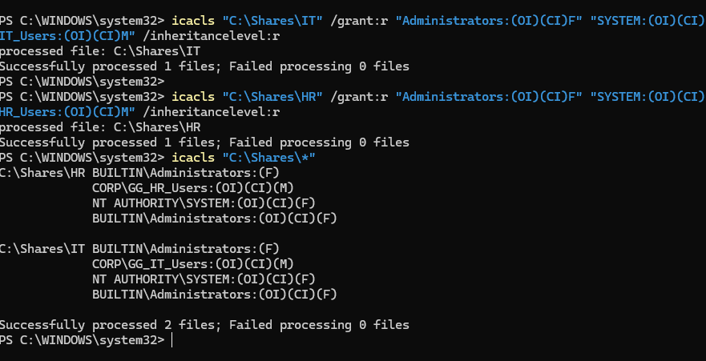
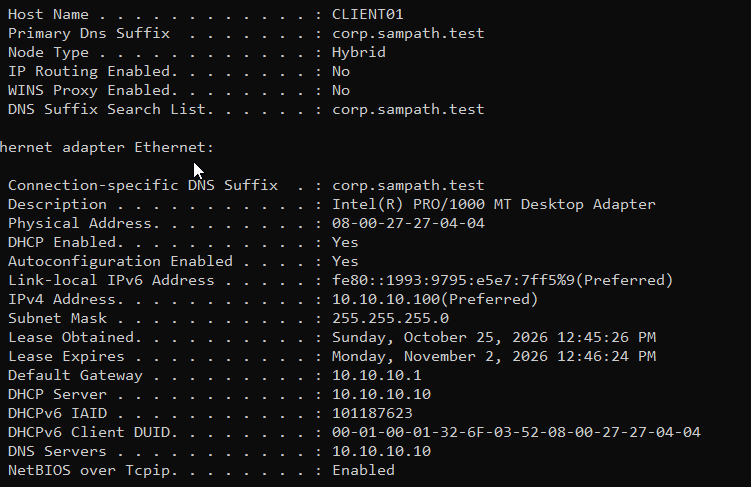
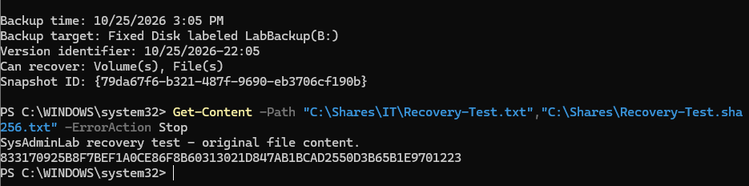

# Windows Server and Active Directory Home Lab

A three-VM home lab built to practice junior system administration: domain services,
network configuration, department file access, PowerShell account management, and
backup/recovery.

**Author:** Sampath Kumar Peddagolla  
**Project name:** SysAdminLab  
**Completed:** October 25, 2026

## Project overview

DC01 provides Active Directory Domain Services (AD DS), Domain Name System (DNS),
and Dynamic Host Configuration Protocol (DHCP). FS01 provides department file shares
and a separate virtual backup disk. CLIENT01 is the domain workstation used to test
standard-user access.

The lab covers:

- A new Active Directory forest and domain: **corp.sampath.test**.
- Domain joining and a computer Group Policy logon-message banner.
- IT and HR security groups with NTFS and SMB share permissions.
- Windows DHCP scope creation, authorization, and a verified client lease.
- CSV-based user provisioning and controlled account disablement/restoration.
- File backup, deletion, recovery, and SHA-256 content comparison.

## Architecture

~~~mermaid
flowchart TB
    subgraph LAN["SysAdminLab NAT Network: 10.10.10.0/24"]
        DC["DC01: 10.10.10.10; AD DS, DNS, DHCP"]
        C["CLIENT01: 10.10.10.100; domain workstation"]
        FS["FS01: 10.10.10.30; IT and HR shares; backup B:"]
        GW["NAT gateway: 10.10.10.1"]
        C -->|"Domain sign-in and DNS"| DC
        C -->|"SMB department files"| FS
        FS -->|"Domain membership"| DC
        C -->|"Outbound route"| GW
    end
    GW --> Internet["Internet"]
~~~

| VM | Address | Role |
|---|---|---|
| DC01 | 10.10.10.10, static | AD DS, DNS, and DHCP |
| FS01 | 10.10.10.30, static | IT/HR SMB shares and file backup/recovery |
| CLIENT01 | 10.10.10.100 in the demonstrated DHCP lease | Domain workstation |
| NAT gateway | 10.10.10.1 | Outbound route for the lab subnet |

All VMs use the **SysAdminLab NAT Network, 10.10.10.0/24**. VirtualBox DHCP is
disabled; DC01 supplies the Windows DHCP scope **10.10.10.100-10.10.10.199**.
The member computers use **10.10.10.10** for DNS.

## Implementation and validation

| Area | Configuration or test | Recorded result |
|---|---|---|
| Domain services | AD DS, DNS records, directory services, SYSVOL/NETLOGON | Initial checks screenshot-verified |
| Group Policy | LabComputers-LogonMessage applied to CLIENT01 | Banner screenshot-verified |
| DHCP | Client lease, gateway, DNS, and domain suffix | CLIENT01 lease screenshot-verified |
| IT access | IT users read/write their department share; HR is denied | Passed by user report |
| HR access | HR Test uses the HR share; IT is denied | Passed by user report |
| Provisioning | Alex Taylor and Maya Patel created from CSV, with department memberships | Script and AD checks confirmed by user report |
| Account lifecycle | Alex disabled, new sign-in blocked, account re-enabled, sign-in restored | Passed by user report |
| Backup catalog | Backup on B: offers file recovery | Screenshot-verified |
| Recovery integrity | Deleted test file restored and its SHA-256 compared with the saved original | True, confirmed by user report |
| Access after recovery | Alex opens the recovered original text; HR stays denied | Confirmed by user report |
| Final checkpoint | A Backup-Recovery snapshot for each VM | Saved by user report |

The guide distinguishes screenshots, user-reported outcomes, expected results, and
untested items. This is a home lab project, not a production deployment.

## Repository contents

| Path | Purpose |
|---|---|
| [docs/project-guide.md](docs/project-guide.md) | Complete editable guide: 39 milestones, exact commands, execution context, explanations, results, and glossary |
| [docs/SysAdminLab_Complete_Project_Guide.pdf](docs/SysAdminLab_Complete_Project_Guide.pdf) | PDF reading copy with contents and diagrams |
| [scripts/DC01/New-LabUsers.ps1](scripts/DC01/New-LabUsers.ps1) | Provision users and department memberships from CSV |
| [scripts/DC01/Disable-LabUser.ps1](scripts/DC01/Disable-LabUser.ps1) | Disable a test account after checking its LabUsers OU path |
| [data/NewUsers.csv](data/NewUsers.csv) | The two fictional user records used in the lab |
| [images](images) | Original lab screenshots supporting selected checks |

## PowerShell automation

These are the scripts used in the lab, rather than a full infrastructure deployment
script. Follow milestones **26-30** of the guide for prerequisites and explanations.

Inside **DC01**, place both scripts and NewUsers.csv in **C:\LabScripts**. The
domain, LabUsers OU, and GG_IT_Users/GG_HR_Users groups must already exist.
Use Windows PowerShell as an administrator with the required AD permissions.

### Create the two CSV users

~~~powershell
& "C:\LabScripts\New-LabUsers.ps1"
~~~

The script maps IT and HR departments to their security groups, checks for existing
usernames, prompts privately for temporary passwords, and requires a password
change at first sign-in. It skips existing usernames. It is not transactional:
a failure after account creation can require investigation.

### Practice account disablement and restoration

~~~powershell
& "C:\LabScripts\Disable-LabUser.ps1" -Username alex.taylor
Enable-ADAccount -Identity alex.taylor
~~~

The first command disables Alex after the script's OU check. The second restores
his enabled state. The full lab procedure tests a fresh sign-in between those
actions; disabling an account is not a test of terminating existing sessions.

## Backup and recovery exercise

1. Added a separate 40 GB virtual disk to FS01.
2. Initialized it as GPT and created **B: LabBackup**, using NTFS.
3. Created **C:\Shares\IT\Recovery-Test.txt** and saved its original SHA-256 hash.
4. Backed up **C:\Shares** to **B:** with Windows Server Backup.
5. Verified backup version **10/25/2026-22:05** in the catalog.
6. Deleted the sample file and restored it from that backup.
7. Confirmed that the restored hash matched the baseline and that Alex could read
   the recovered file through the IT share.

See milestones **31-39** for the exact commands, their effects, and evidence.
The demonstrated recovery is a file-level exercise. The backup VDI and source VDI
are on the same physical laptop.

## Selected evidence

### Department NTFS permissions

The original ACL output shows the department group, SYSTEM, and Administrators
entries on the IT and HR folders.

### CLIENT01 DHCP lease

The client output shows address **10.10.10.100**, DHCP/DNS server **10.10.10.10**,
gateway **10.10.10.1**, and the domain suffix.

### Backup catalog and original hash baseline

This screenshot records the available recovery version and the original test-file
text/hash. The subsequent restoration and final True comparison were confirmed
by user report, rather than this screenshot.

## Scope and follow-up

- CLIENT01 currently uses the temporary Windows 10 Pro guest. Migration to a
  supported Windows 11 Pro release remains planned.
- Maya's AD properties and group membership were checked; her first sign-in and
  share access were not tested.
- Scheduled, off-host, full-server, and system-state backups were not implemented.
- No recovery duration or production-scale performance result was measured.
- Linux administration and cloud infrastructure are separate next projects.

The repository contains documentation, scripts, sample data, and selected evidence.
VM disks, installation ISOs, backup images, and private credentials are excluded.
